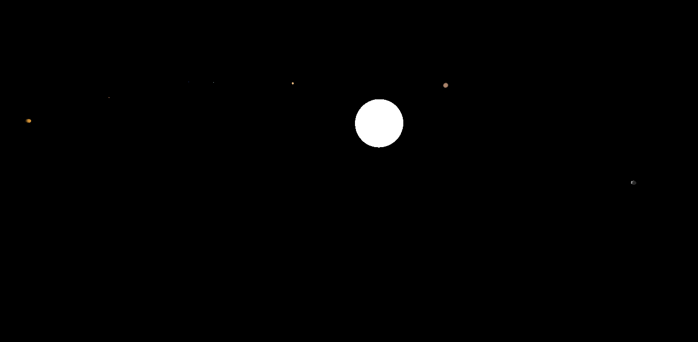

# gravity-simulator

3-Dimensional Realistic Gravity Simulator, written in Rust using -

# Installation

This project requies - https://wiki.libsdl.org/SDL3/README-linux

1. -

# Usage

Once running, the program launches 4 threads:
* main (window input)
* Physics
* Render
* Console

Controls:
* WASD to move around in the XY plane
* SPACE/LCTRL to move in the Z plane
* Mouse to look around (alternatively, can use arrow keys)
* Scroll wheel to increase / decrease camera speed
* ESCAPE to release the mouse and control of the window

In the terminal, type ``help`` to see a list of commands.

Some important commands:
* ``get / set``: get or set important variables or object values
* ``lock / unlock``: lock the camera position relative to a body
* ``add [name] / remove [name]``: add or remove bodies

Once opened, the program initializes with spawning our solar system with appropriate sizes, distances, and velocities.
It spawns the sun, Mercury to Neptune, as well as the moon.
The radii are 100x larger, with the exception of the sun's radius being 10x larger.
The time scaling is initialized to one week per second.

The camera is initialized to going 1000x the speed of light.

Note: the moon does spawn, but with Earth at its scaled size, it is inside the Earth (no collision).

This project is still being developed and will probably have major changes.